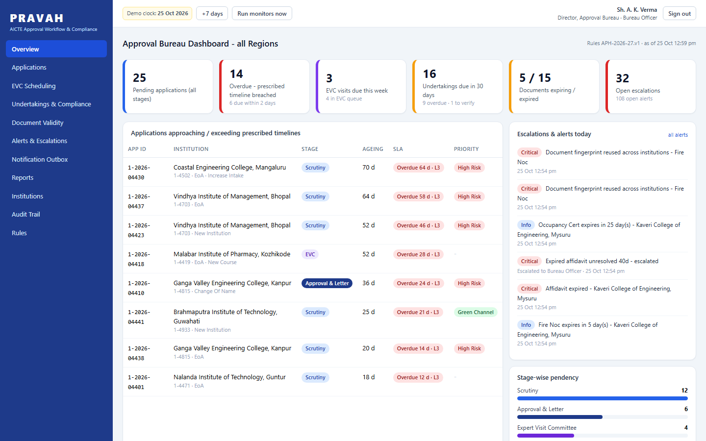
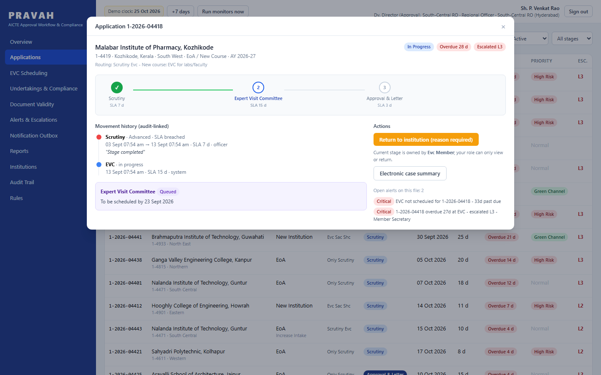
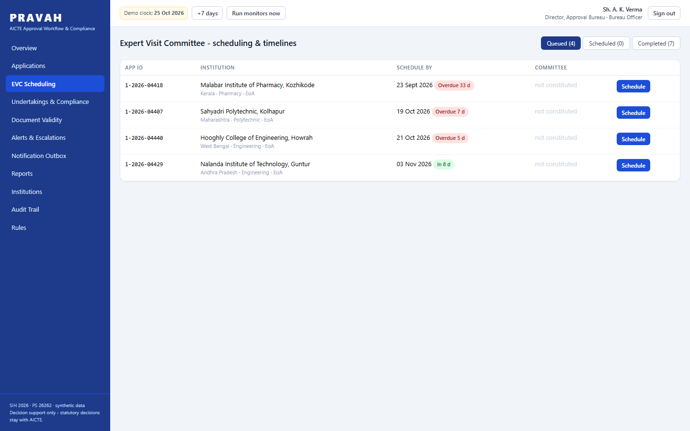

# PRAVAH

Prototype for Smart India Hackathon 2026, problem statement **SIH26262** (AICTE):
*Integrated Approval Workflow Automation, Compliance Monitoring and Alert Management*.

AICTE approves and re-approves thousands of technical institutions every year. Each application moves
through fixed stages (scrutiny, expert visit, SAC/SHC, approval letter), each with a prescribed timeline.
Institutions also carry obligations beyond the approval itself: undertakings they promised to fulfil,
lease deeds and fire NOCs that expire. Keeping track of all of that is mostly manual today, so files sit
idle, deadlines pass quietly and nobody is told until it is too late.

PRAVAH is a small working system that keeps the calendar for everyone involved.

## What it does

- **Routes applications** through the right stages using rules in a JSON file (category and change type
  decide the pipeline). Each stage has an owner role and a timeline.
- **Watches deadlines.** Warns two days before a stage runs late, marks it overdue, then escalates in three
  steps: Regional Officer, Approval Bureau, Member Secretary.
- **Schedules Expert Visit Committees.** Queues visits, suggests clubbing visits in the same State, and
  refuses committee members from the institution's own State.
- **Tracks undertakings and document validity** as dated obligations: reminders at 30/15/7/1 days, overdue
  flags, escalation when ignored, and a verification step for the evidence institutions upload.
- **Notifies** by email, SMS and WhatsApp. The channels are simulated here; messages land in an outbox you
  can read in the UI.
- **Scores compliance.** Institutions with a clean record get a faster lane with shorter timelines. No stage
  is ever skipped.
- **Issues approval letters** as PDFs with a QR code, and a public page where anyone can check a letter.
- **Keeps a tamper-evident audit trail** (each entry hashes the previous one). Returning a file to an
  institution requires a written reason.

The system reminds and routes; it does not decide. Every state change needs a signed-in user with the
right role.

## Running it

Python 3.11 or newer.

```
pip install -r requirements.txt
python -m uvicorn app.main:app --port 8062
```

Open http://127.0.0.1:8062. On first start a SQLite database is created and filled with synthetic data.
API docs are at `/docs`. `python tests/smoke.py` runs an end-to-end check against the running server.

Environment variables: `DATABASE_URL` (PostgreSQL instead of SQLite), `PRAVAH_JWT_SECRET`,
`MONITOR_INTERVAL_SECONDS` (background deadline scanner; `0` turns it off).

## Demo accounts

Password is `demo123` for all of them.

| Username | Who |
| --- | --- |
| `bureau` | Director, Approval Bureau (sees all regions) |
| `ro.south`, `ro.southcentral`, `ro.southwest`, `ro.west`, `ro.north`, `ro.east` | Regional Officers |
| `ms` | Member Secretary |
| `evc.iyer` | Expert Visit Committee member |
| `inst.nalanda`, `inst.deccan`, `inst.coastal` | Institutions |
| `admin` | Edits the rules, resets the demo data |

Adding `?demo=<username>` to the URL signs that account in directly, e.g. `/?demo=bureau#/overview`.

A five-minute walk-through: sign in as `bureau`, open an overdue application from the overview and read its
movement history. Go to EVC Scheduling and schedule a queued visit (try picking an expert from the same State
to see the guard). Press **+7 days** in the header to move the demo clock and watch reminders and escalations
appear in Alerts and the Outbox. Open an approved application and follow the verification link under the QR.
Admin > Rules lets you change a timeline and save it as a new version.

## What is simulated

All data is made up: institutions, officers, application numbers, documents. Notifications are written to
the database and `data/outbox.log` instead of being sent. The timelines, routing rules, escalation ladder
and reminder windows are illustrative placeholders; real values would come from the Approval Process Handbook
and can be changed from the Rules screen without touching code.

## Layout

```
app/          FastAPI backend: workflow.py (routing, transitions), monitor.py (deadline scans),
              scoring.py, notify.py, audit.py, seed.py, api_core.py, api_compliance.py
rules/        workflow_rules.json: stages, timelines, pipelines, routing, escalation, EVC experts
frontend/     React 18 + Tailwind loaded as plain scripts (no build step); libraries are vendored
tests/        smoke.py
screenshots/
```

## Screenshots






